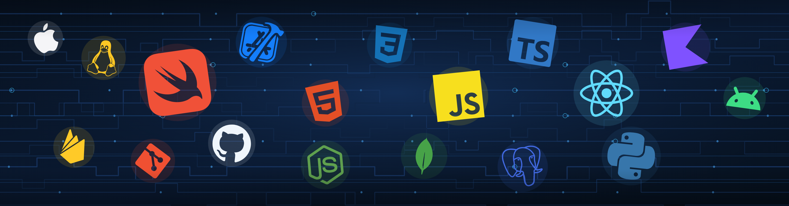

  

<h1 align="center">Hey, I am Dhruv!</h1>
<h2 align="center">Software Developer | Building scalable production apps</h2>

<h2>💬 Want To Contact Me?</h2>

  
  
  
  
  
  

<h2>🛠️ Language and Tools I use:</h2>

  
  
  
  
  
  
  
  
  
  
  
  
  
  
  
  
  
  
  
  
  
  
  
  
  
  

MVVM, MVP, and Clean Architecture. REST API design, data synchronization, mobile app security, TestFlight, and App Store deployment. MapKit, Core Animation, and Auto Layout.

## Projects

- **[krypticGrind](https://github.com/dhruvgohil448/krypticGrind-Ai)** — iOS, SwiftUI, VisionKit, REST. Gamified competitive programming app with 500+ beta users. AI recommendations improved solve speed by 15%.
- **[CodeNest](https://github.com/dhruvgohil448/CodeNest)** — iOS, SwiftUI, UIKit, REST. Analyzes Codeforces performance across 10,000+ records. Visual insights and navigation changes raised daily usage by 18%.
- **[ERP-Based Student Management System](https://github.com/dhruvgohil448/ERP-based-Student-Management-System-)** — HTML, CSS, JavaScript, MySQL. Role-based ERP for 1,000+ users covering attendance, notices, and fee payments. Automated workflows cut manual workload by 40%, and query work improved performance by 35%.
- **[ReadBetter](https://github.com/dhruvgohil448/ReadBetter---Where-Words-Feel-Friendly)** — iOS, SwiftUI, VisionKit, speech recognition. Swift Student Challenge app. Fully offline, dyslexia-friendly reading with accessible reading modes and focus tools.

## My Statistics

  

## Recent Activities

<!--START_SECTION:activity-->
<!--END_SECTION:activity-->
